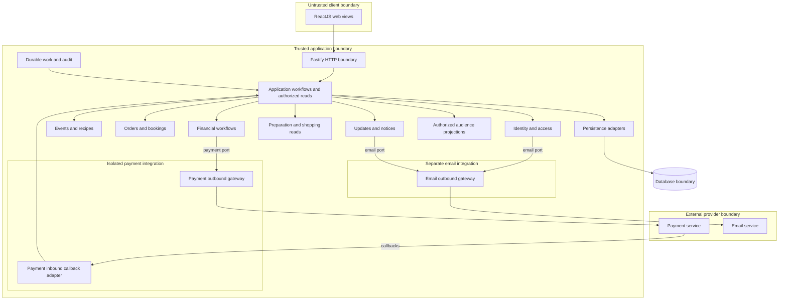
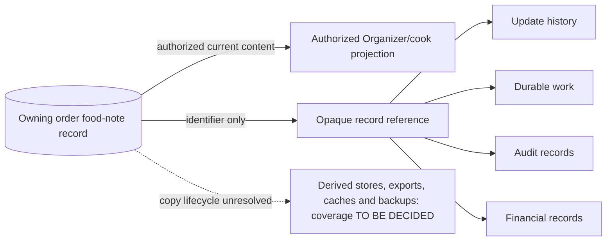

# Architecture

This document follows the twelve sections of [arc42](https://arc42.org/overview/), with Required Architecture Inputs and Open Questions retained as project-specific appendices. Section 7 records deployment uncertainty only; deployment topology remains outside this document’s requested scope.

## 1. Introduction and Goals

This document owns how the system is built. [REQUIREMENTS.md](REQUIREMENTS.md) owns behavior; [DESIGN.md](DESIGN.md) owns visual and interaction constraints. This is a design for a system with no implementation. Requirements marked ASSUMPTION in the source remain adopted first-release requirements. **CONFIRMED** identifies an explicit architecture instruction, **PROPOSED** an unconfirmed technical recommendation, **UNKNOWN** a missing fact, and **TO BE DECIDED** a pending decision.

The system supports cooking events, reviewed food needs, paid seats, and preparation planning. Architecture priorities are consistent capacity and financial state, private audience-specific data, durable changes, and timely accessible staff views. Organizer, Attendee and Admin are account actors; cook and shopper are event assignments. Their permissions remain defined by REQUIREMENTS.md. Section 10 records measurable quality scenarios.

## 2. Architecture Constraints

Payment outbound integration must be fully isolated from email integration, as explicitly required. This is a confirmed logical boundary; it does not require separate deployments.

Developer choices require Node.js, Fastify, ReactJS and React Native; the framework/runtime label conflict and mobile scope remain AQ-1 and AQ-2. The Required Architecture Inputs appendix records each input once. First-release behavior is English, USD and online payment, with no additional features inferred. DESIGN.md governs visual tokens and frontend interactions. Jurisdictions are UNKNOWN; detailed security controls belong in SECURITY.md.

## 3. Context and Scope

| External actor or system | Interaction at the system boundary |
| --- | --- |
| Visitor | Browse public calendar/event information and follow public QR URLs. |
| Organizer | Manage owned events, recipes, food reviews, staff assignments and financial records. |
| Attendee | Verify/sign in, submit and accept food requests, pay, inspect bookings and cancel when eligible. |
| Cook / shopper | Read current assigned-event preparation information and persistent updates with different privacy projections. |
| Admin | Manage Admin grants and suspension, cancel events, and inspect/reconcile/retry permitted financial actions. |
| Payment service | Connected-account capabilities, checkout, payment evidence, refunds, fees and payouts; provider is TO BE DECIDED. |
| Email service | Verification/access links and required notices; provider is TO BE DECIDED. |

Clients and provider messages cross trust boundaries before application validation. Section 5 shows the component and trust-boundary diagram; section 8 defines boundary enforcement. Native-app scope remains unresolved and is not added to the required web workflows.

## 4. Solution Strategy

**PROPOSED: a modular monolith**, using the Node.js/Fastify interpretation pending AQ-1, with a ReactJS web client and one PostgreSQL database. Logical modules separate business responsibilities without separate services. Transactions are necessary for seat allocation, booking confirmation, and financial deduplication; one database keeps these operations simple at the stated acceptance load. PostgreSQL selection remains unconfirmed. No separate message broker or cache is proposed.

**PROPOSED: application workflows coordinate domain rules and persistence through interfaces.** Domain rules do not depend on Fastify, React, SQL, or provider SDKs. HTTP handlers identify the actor, validate request shape, invoke workflows, and return audience-specific results. The server owns authorization, cutoffs, prices, transitions, and ingredient calculations. Client validation assists entry but cannot authorize a transition.

**PROPOSED: durable background work in the same application architecture.** Commit required notices, staff-update records, and outbound work with the originating state change. A database-backed dispatcher resumes scheduled tasks after restarts and routes payment and email work to separate handlers with independent retry state and execution capacity. Email failures or backlogs must not block payment, refund or payout dispatch. Tasks cover hold/order expiry, event completion, refunds, payouts, email, reconciliation, and retention. This is a logical responsibility, not a deployment topology. Time-sensitive commands also check the server clock and stored deadlines; scheduler delay must not extend eligibility.

## 5. Building Block View

Statuses describe how fully the responsibility is defined by the inputs; module boundaries are PROPOSED except the confirmed separation of payment and email outbound gateways. SUPPORTED does not mean implemented or tested.

| Logical component | Responsibilities and business-rule enforcement | Owned data | Status and exact requirement IDs |
| --- | --- | --- | --- |
| Web presentation | Render workflows, retain inputs, show canonical states and connection status; no authoritative business transitions | Transient form and view state only | SUPPORTED — FR-1.12, FR-1.13, FR-2.10, FR-5.2, FR-5.6, FR-10.12; NFR-3.1–NFR-3.6 |
| Mobile presentation | React Native supplied; workflow coverage unresolved | TO BE DECIDED | TO BE DECIDED — no native-app requirement ID |
| Identity and access | Verify/sign in/out; evaluate the current session, ownership, role, suspension and event assignment for every protected command and read; Admin role management | Accounts, verification/sign-in records, sessions, role grants, suspension | PARTIALLY DEFINED — FR-6.1–FR-6.7, FR-6.10–FR-6.18; FR-11.2; session mechanics unresolved. Threats: T-001, T-003, T-014, T-015, T-022, T-035. |
| Events and recipes | Event validation, public-field preview, launch checks, immutable snapshots, staff assignments, permanent URL/QR, calendar visibility | Events, assignments, reusable dishes, ingredients, event recipe snapshots | SUPPORTED — FR-1.1–FR-1.15; FR-2.1–FR-2.16; FR-5.1–FR-5.8, FR-5.10; FR-6.8, FR-6.9; FR-7.1–FR-7.8. Threats: T-023, T-024, T-026, T-036. |
| Orders and bookings | Consent evidence, review/acceptance, order transitions, cutoff, capacity and hold rules, accepted recipe preservation, cancellation | Orders, food needs, consent, proposals, accepted recipes, holds, bookings | SUPPORTED — FR-3.1–FR-3.26; FR-5.9; FR-7.9, FR-7.10; FR-8.1–FR-8.9, FR-8.24; FR-9.1–FR-9.7, FR-9.11; FR-11.7. Threats: T-025, T-028, T-037, T-041. |
| Financial workflows | Account capability checks, authentic payment-evidence validation, reconciliation, transition and side-effect idempotency by operation identity, refund limits, payout eligibility and deduplication | Connected-account references/status, payment attempts, receipts, refunds, payouts, financial operation identifiers | PARTIALLY DEFINED — FR-2.5; FR-8.10–FR-8.25; FR-9.4, FR-9.7–FR-9.10, FR-9.12–FR-9.18; provider contract unresolved. Threats: T-002, T-004–T-006, T-016–T-018, T-032, T-033, T-039, T-040. |
| Payment outbound gateway | Implements the financial application’s payment port for account capabilities, checkout, reconciliation, refunds, fees and payouts; translates provider results without deciding business eligibility | Payment-only SDK/client configuration and credentials; no business-record ownership | SUPPORTED — explicit architecture constraint; FR-2.5, FR-8.10, FR-8.21–FR-8.23, FR-9.4, FR-9.12–FR-9.18; provider selection remains AQ-3 |
| Email outbound gateway | Implements email delivery for account access and notices; cannot invoke payment operations | Email-only SDK/client configuration and credentials; delivery records remain owned by updates/notices | SUPPORTED — explicit architecture constraint; FR-6.2, FR-6.3, FR-4.12–FR-4.14; provider selection remains AQ-4 |
| Preparation and shopping reads | Deterministic totals, distinct variants, cook/shopper projections; exclude unpaid/cancelled orders | Derived results only; source ownership remains with events and orders | SUPPORTED — FR-4.5–FR-4.8; FR-10.1–FR-10.13 |
| Updates and notices | Durable staff history, current-assignment authorization for every read and replay, account notices, privacy-filtered email dispatch | Update references/cursors, account notices, delivery status; cursors never confer access | PARTIALLY DEFINED — FR-4.1–FR-4.15; NFR-1.1–NFR-1.3; email provider unresolved. Threats: T-010, T-012, T-021, T-042, T-044. |
| Durable work and records | Dispatch scheduled/retry work through owning workflows; record linked audit outcomes; retain only opaque private-note references; execute owner-defined retention | Pending-work metadata, audit records; no ownership of source business records or private-note content | SUPPORTED — FR-2.16, FR-3.24, FR-8.7, FR-8.25, FR-9.13, FR-11.3–FR-11.9; NFR-1.5, NFR-2.1, NFR-2.5. Threats: T-006, T-007, T-011, T-030, T-034, T-043. |

### Component and trust-boundary diagram

Internal boxes are logical boundaries within one application, not independently deployed services. Payment/email gateway separation is confirmed; other boundaries remain PROPOSED. Arrows show runtime calls through application-owned ports, not imports of concrete adapters. Native-app scope remains AQ-2.



## 6. Runtime View

1. **Publish and discover:** Organizer input passes identity and event validation; launch checks complete recipes and payment-account capabilities before committing the launched snapshot and URL. Calendar/public reads return only approved public fields. The QR encodes that same URL; cancellation preserves it with a notice.
2. **Review and prepare:** submission persists an order and staff update atomically. Unchanged orders become Ready for Payment; changed dishes require Organizer proposals and Attendee acceptance. Neither review nor acceptance reserves a seat. Confirmed recipes feed cook views and deterministic shopping totals. Audience projections remove unauthorized fields before crossing the client boundary. The consent interaction names the food information, recipients and purpose before the Attendee acts. Threats: T-008–T-010, T-019, T-025, T-028, T-037, T-041.
3. **Cancel and settle:** eligible cancellation commits the cancellation, released seat, update and refund work together. Browser/client returns are never payment evidence. Authenticated callback or reconciliation evidence re-enters the same workflow, which checks operation identity, amount, currency, event and hold state before applying each authorized transition and external side effect at most once. Later authorized transitions may continue the defined payment, refund, or payout lifecycle. Event cancellation initiates refunds for paid bookings; completion initiates an eligible payout. Every outbound payment-service operation passes through the payment outbound gateway; incoming callbacks use a distinct payment inbound adapter. Threats: T-002, T-004–T-006, T-016–T-018, T-032, T-033, T-039, T-040.
4. **Notify and reconnect:** committed update references feed polling and account notices. Every staff current-state or replay request first rechecks the current assignment; a cursor selects history but never establishes entitlement. Email delivery uses the separate email outbound gateway and is independent of notice persistence and financial dispatch. Reconnection returns one authorized, consistent revision of current state and missed history; clients display staleness until refreshed. Retention tasks invoke owners to delete private notes and age financial records according to the required periods. Threats: T-010, T-012, T-013, T-020, T-021, T-042–T-044.

```mermaid
sequenceDiagram
  actor Attendee
  participant API as Application workflows
  participant DB as Transactional store
  participant Gateway as Payment outbound gateway
  participant Pay as Payment service
  participant Callback as Payment inbound adapter
  participant Staff as Staff view
  Attendee->>API: Checkout accepted order
  API->>DB: Check access, cutoff, unresolved payments#59; atomically reserve seat
  DB-->>API: Persisted hold and payment attempt
  API->>Gateway: Initiate payment through financial payment port
  Gateway->>Pay: Full-price payment with operation identity
  Pay-->>Gateway: Checkout response
  Gateway-->>API: Normalized checkout result
  API-->>Attendee: Checkout details and hold expiry
  Attendee->>API: Browser/client payment return
  API->>DB: Read current authoritative payment state#59; return causes no transition
  API-->>Attendee: Current state#59; Pending unless provider evidence was already applied
  alt Provider callback
    Pay->>Callback: Payment result
    Callback->>API: Verified and normalized payment evidence
  else Reconciliation
    API->>Gateway: Query unresolved payment through financial payment port
    Gateway->>Pay: Fetch payment result
    Pay-->>Gateway: Provider result
    Gateway-->>API: Normalized payment evidence
  end
  API->>DB: Deduplicate and validate authentic evidence, amount, currency, event and hold
  alt Correct payment during valid hold
    API->>DB: Replace hold with booking#59; persist updates and notices
  else Late, incorrect, duplicate or cancelled-event payment
    API->>DB: Persist full-refund work#59; no new confirmed booking
  else Result unresolved
    API->>DB: Keep payment Pending#59; block another payment
  end
  Staff->>API: Poll after saved cursor
  API->>DB: Recheck current assignment; read one revision of authorized state and updates
  API-->>Staff: Filtered update and current preparation totals
```

## 7. Deployment View

Deployment environment is UNKNOWN (AQ-5). No deployment topology is specified, as requested. The section 5 diagram describes logical components only. Any later deployment decision must preserve transactional consistency, restart durability, update deadlines and monthly read availability; see section 10.

## 8. Crosscutting Concepts

### API and frontend

**PROPOSED:** explicit command endpoints for actions such as launch, accept proposal, checkout, and cancel, plus read endpoints for public and authorized views. Do not expose arbitrary state updates. Return canonical states, field-specific errors, deadlines, and update cursors. Keep entered values on failed submissions (FR-1.12, FR-1.13). Stable public event URLs are also the only QR payload (FR-2.8, FR-2.9, FR-2.15).

**PROPOSED:** connected staff clients poll every two seconds using a durable cursor; on every request and reconnect, authorize the current assignment before fetching current state and missed updates together. A cursor is only a position and never an authorization fact. Bound responses with paging and use a consistent revision so an update is neither skipped nor mistaken for current state. The interval is a recommendation, not evidence that NFR-1.1–NFR-1.3 are met; validate end-to-end display latency under the required load. Detect connection failures, show the last successful update time, and retain focus and reading position. Threats: T-010, T-012, T-021, T-042.

ReactJS implements the calendar, event and account workflows, and staff/administration views justified by the requirements. Apply DESIGN.md tokens, permitted color pairs, system typography, content-driven reflow, exact state names, and accessible interaction patterns. Support keyboard actions, 200% text size, 320-pixel forms/details/lists, and stable live-update focus (NFR-3.1–NFR-3.6). Printing shopping lists and downloading QR codes belong to presentation; their data comes from authorized server reads.

React Native is a confirmed framework choice, but mobile feature coverage and platform targets are TO BE DECIDED. **PROPOSED:** reuse API contracts and presentation-independent formatting where appropriate; use platform-specific rendering and accessibility. Do not infer additional mobile features or treat mobile web support as a native-app specification.

### Persistence and consistency

**PROPOSED:** relational records for accounts and sessions; events and assignments; dishes, shared ingredients and recipe entries; orders, consent and proposals; holds and bookings; payments, refunds and payouts; notices, staff updates, audit records and pending work. Module ownership is defined in section 5. Store USD amounts as integer cents and ingredient quantities as exact decimals. Store schedule instants with the event time-zone identifier; reject ambiguous or invalid local times until the Organizer resolves them.

Snapshot base recipes at launch and accepted recipes at confirmation so reusable-dish edits cannot change commitments (FR-7.8, FR-7.9). Preserve immutable published fields. Enforce one active order per Attendee/event and at most one booking per order through transactional constraints and workflows. Ingredient totals are derived from confirmed, uncancelled accepted recipes, grouped by ingredient identity and unit family, with the exact conversions, 10% extra, and upward rounding in FR-10.2–FR-10.11.

**PROPOSED:** serialize capacity-changing operations on the event record within short database transactions. Checkout, confirmation, cancellation, and capacity edits use the same locking rule; expired holds never count toward occupancy. Confirmation atomically replaces a valid hold with a booking. Never hold a database transaction open during a provider call. Persist operation identifiers and provider references to deduplicate callbacks, retries, refunds and payouts.

The provider owns its charge, refund and payout results; the application owns their validated local records and booking eligibility. A browser return cannot confirm payment. Validate provider evidence, amount, currency, hold validity, and event state before confirmation. Unknown payment results remain Pending and block another payment for that Attendee/event even if the hold expires. Late, incorrect, duplicate or cancelled-event payments trigger full refunds. Refund totals cannot exceed receipts; payouts exclude unresolved payments and refund obligations and cannot pay the same proceeds twice (FR-8.12–FR-8.24; FR-9.8–FR-9.18).

### Isolated outbound gateways

**CONFIRMED:** the payment outbound gateway is a dedicated integration boundary. Financial workflows own its provider-independent port and are its only callers. It covers all outbound payment-service access, including account capability checks and reconciliation reads. The gateway owns payment-specific protocol translation, SDK/client configuration, credentials, timeouts and error mapping. It receives stable operation identifiers from financial workflows; eligibility, amount validation, idempotency records, refund caps and payout accounting remain in those workflows. The gateway cannot mutate business records directly.

The email outbound gateway has a separate port, implementation, SDK/client instance, credentials, configuration and delivery error handling. Identity and notice workflows call it. Neither gateway imports, invokes or configures the other. Do not introduce a combined payment/email provider adapter, generic external-services facade, shared mutable provider client, or shared retry/failure state. Provider-neutral utilities may be reused only if they carry no credentials, provider state or business policies.

Payment callbacks enter through a payment-specific inbound adapter, which validates and normalizes provider evidence before invoking application workflows. Outbound reconciliation still uses the payment gateway. Committed financial outcomes produce notice work at the application layer; the payment gateway never sends email. Payment and email work use separate handlers, retry budgets and execution capacity even if the proposed database-backed scheduling infrastructure is shared. An email outage or backlog must not delay the required refund submission deadline (NFR-1.5). Exact execution settings remain AQ-5.

### Authentication and privacy boundaries

Email verification and sign-in links enter the identity workflow. **PROPOSED:** server-stored, revocable sessions; the web client holds only an opaque session identifier. Exact link/session lifetimes and mobile transport are TO BE DECIDED. Server workflows check current ownership, assignment, role, and suspension for every protected action and read. Suspension blocks new events/orders while preserving required cancellation/refund access (FR-6.12, FR-6.13).

Build separate public, Attendee, Organizer, cook, shopper, and Admin projections on the server. Public results exclude exact addresses and private records; addresses are restricted to the audiences in FR-2.12. Attendees see only their own orders/payments. Food-note sharing requires consent; shopper results exclude names and private notes, and emails exclude private notes and exact addresses. Revoking staff access applies to subsequent reads, including update replay (FR-3.10; FR-4.7; FR-4.14; FR-6.10; FR-11.1, FR-11.2).

Record actor, time, outcome, affected record and operation for required state changes; financial audit entries also carry the local operation and provider reference when present. Store private food-note content only in its owning order records; financial records, updates, jobs and audit records carry only opaque references. This supports consent withdrawal and 90-day deletion without retained operational copies. Derived-store, export, cache and backup deletion/restoration coverage remains unresolved under AQ-7 and SECURITY.md OD-010. Retain required financial references, amounts, states and action records for 24 months after last change, excluding private food notes (FR-11.3–FR-11.9). Threats: T-007, T-011, T-019, T-029, T-030, T-034, T-043.



### Dependency rules

- **DR-1:** Presentation depends only on API contracts and design/formatting utilities. Clients never access the database or authorize business transitions.
- **DR-2:** HTTP handlers and durable-work entry points call application workflows; workflows call domain policies and interfaces. Domain code never imports presentation, transport, persistence or provider code.
- **DR-3:** Infrastructure adapters implement interfaces owned by the application/domain boundary. Wiring supplies them to workflows; business code does not import concrete adapters. Logical dependencies remain inward even when runtime calls reach a vendor.
- **DR-4:** Each persisted business record has exactly one owner from the component table. Only that owner's operations mutate it. Cross-owner workflows coordinate these operations in a shared transaction; modules do not modify another owner's tables directly.
- **DR-5:** Cross-module orchestration lives above the modules. Modules never call back into orchestration or form mutual dependencies. Access checks receive ownership/assignment facts through interfaces; event modules do not depend on identity storage internals.
- **DR-6:** Source records flow into audience-specific reads and derived totals, then into presentation. Derived results, notifications and client state cannot write back as authoritative orders, recipes or financial results.
- **DR-7:** Business changes flow into transactional update/work records, then delivery adapters. Callback handlers and retries re-enter workflows with deduplication; delivery success never substitutes for a business-state commit.
- **DR-8:** External services are reached only through adapters. Browser returns are non-authoritative. Provider payloads become authenticated, validated, deduplicated application facts before affecting bookings or balances. Private data is filtered before every client/provider boundary, including update replay and email. Threats: T-002, T-004, T-008–T-010, T-016, T-019, T-031, T-039.
- **DR-9:** Only financial workflows may call the payment outbound port; only its dedicated gateway may make outbound payment-provider calls. Identity and notice workflows use the distinct email port and gateway. No dependency, invocation, shared provider client, credentials or mutable retry/failure state may cross between the two gateways. Inbound payment callbacks enter workflows through their separate adapter.

## 9. Architectural Decisions

Developer framework choices are confirmed subject to the terminology conflict; payment/email gateway isolation is **CONFIRMED** by explicit instruction. Other architectural recommendations below remain **PROPOSED**. Their implementation details remain in sections 4 and 8.

| Decision | Rationale and consequence | Pending question |
| --- | --- | --- |
| **CONFIRMED: isolated payment and email outbound gateways** | Separate ports, adapters, credentials, retry state and execution capacity prevent email integration from controlling financial operations. | Isolation is decided; provider choices remain AQ-3/AQ-4 and execution settings AQ-5. |
| Modular monolith and one PostgreSQL database | Keeps capacity and booking changes transactional without distributed coordination; modules must honor ownership boundaries. | AQ-5 |
| HTTP JSON commands and reads | Makes business transitions explicit and supports both supplied client frameworks; native contracts need scope confirmation. | AQ-2 |
| Durable database-backed work and update history | Survives restarts and external service failures; dispatch and retries must be deduplicated. | AQ-3, AQ-5 |
| Two-second cursor polling | Simple staff delivery with durable replay; actual display deadlines require load validation. | AQ-6 |
| Server-side revocable sessions | Centralizes logout and authenticated access; link/session lifecycle and native transport remain pending. | AQ-4 |
| Server-filtered projections and private-note references | Enforces audience boundaries and avoids retained note copies; deletion coverage needs definition. | AQ-7 |

## 10. Quality Requirements

These are required acceptance scenarios, not measured results. Use the load recorded in Required Architecture Inputs; payment processing and email delivery durations remain UNKNOWN.

| Scenario | Required outcome | Architectural support and validation |
| --- | --- | --- |
| Accepted change reaches connected staff; client reconnects | 95% within 5 seconds, all within 30 seconds; current data restored within 10 seconds (NFR-1.1–NFR-1.3). | Durable cursors and polling; measure through client display, including polling traffic. |
| Public event, calendar and account reads under load | 95% complete within 2 seconds; public/account reads available 99.5% monthly, including planned downtime (NFR-1.4, NFR-2.4). | Audience-specific database reads; verify latency and the required one-minute read probes. |
| Authorized refund with payment provider available while email is failing or backlogged | Submit within 1 minute (NFR-1.5); email failure cannot change financial state. | Verify independent dispatch under email failure; check that payment integration has no email dependency and measure acceptance-to-provider-submission time. |
| Restart after acknowledged change; simultaneous last-seat checkout | Preserve changes; confirmed bookings plus unexpired holds never exceed capacity (NFR-2.1, NFR-2.2). | Commit before acknowledgement; test restart recovery and conflicting transactions. |
| Recalculate identical confirmed recipes | Identical ingredient totals (NFR-2.3). | Exact arithmetic and deterministic conversion/rounding rules. |
| Keyboard, enlarged text, narrow viewport or live update | Meet every NFR-3.1–NFR-3.6 accessibility constraint. | Verify rendered workflows, reading order and focus preservation against DESIGN.md. |
| Read by a different audience or remove private notes | Enforce FR-2.12, FR-4.7, FR-4.14 and FR-11.1–FR-11.7. | Verify server projections, authorization and retention workflows; detailed controls deferred to SECURITY.md. |

## 11. Risks and Technical Debt

| Risk | Architectural consequence and follow-up |
| --- | --- |
| Payment provider cannot support required refunds or payout timing | Blocks the financial design; resolve capability fit before integration (AQ-3). |
| Polling or work dispatch misses required deadlines | Proposed mechanisms remain unvalidated; test at the stated load before accepting them (AQ-5, AQ-6). |
| Private notes survive in snapshots or operational records | Retention obligations may be violated; settle classification and deletion coverage (AQ-7). |
| Native scope and supplied technology labels remain ambiguous | Implementation boundaries remain provisional (AQ-1, AQ-2). |

No implementation exists, so implementation technical debt has not been assessed. Unresolved architectural decisions are recorded only in Open Questions; these risks reference those decisions.

## 12. Glossary

| Term | Meaning |
| --- | --- |
| Active order | Draft, Pending Review, Ready for Payment, Payment Pending or Confirmed order, as defined in REQUIREMENTS.md. |
| Seat hold | Temporary capacity reservation lasting 15 minutes or until the booking cutoff, whichever is earlier. |
| Confirmed attendance | Confirmed, uncancelled bookings; excludes unresolved payments and refunded-but-cancelled bookings. |
| Accepted recipe | Attendee-accepted dish recipe preserved for a confirmed order; omissions contribute zero portions. |
| Projection | Server-produced view containing only fields authorized for its audience. |
| Durable work | Persisted pending action that can resume after a service restart. |
| Update cursor | Position used to retrieve missed persistent staff updates. |

Business state names and all other product terms remain authoritative in REQUIREMENTS.md.

## Required Architecture Inputs

| Field | Input |
| --- | --- |
| Requirements source | `REQUIREMENTS.md` |
| Design source | `DESIGN.md` |
| Target surfaces | Public and authenticated website, including narrow viewports, from the requirements. Mobile application scope is UNKNOWN; React Native is supplied separately as a developer choice. See AQ-2. |
| Runtime and deployment environment | Developer input names Fastify as the server runtime. Node.js is also specified, under server framework. These labels conflict with their technical roles; see AQ-1. Deployment environment is UNKNOWN. |
| Server framework | Developer input: Node.js. PROPOSED interpretation: Fastify framework running on Node.js, preserving both choices; confirmation is TO BE DECIDED in AQ-1. |
| Client framework(s) | Confirmed developer choices: ReactJS (web), React Native (mobile). Mobile scope remains unresolved. |
| API style and integration model | PROPOSED: HTTP JSON request/response API, cursor-based polling for staff updates, and server-side integration ports. CONFIRMED: dedicated, isolated payment outbound gateway and separate email outbound gateway; no combined provider adapter. Provider callbacks and reconciliation enter application workflows. Providers are TO BE DECIDED. |
| Authentication and session model | Required: verified email, email-link sign-in, logout, dual Organizer/Attendee capability, Admin grants, and event-specific staff assignments. PROPOSED: revocable server-side sessions with an opaque browser cookie. Mobile session transport is TO BE DECIDED. |
| Data model and scale expectations | Required entities and state machines come from the requirements. Acceptance load: 1,000 launched events, 10,000 confirmed bookings, 200 active sessions, 20 user actions/second; growth expectations are UNKNOWN. PROPOSED: one relational database with transactions. |
| Security expectations | Required authorization, consent, audience filtering, audit, and retention boundaries are preserved below. Detailed controls are deferred to `SECURITY.md`. Jurisdictions and statutory duties are UNKNOWN. |

## Open Questions

- **AQ-1 — Input terminology:** Node.js was supplied as framework and Fastify as runtime. PROPOSED interpretation is Node.js runtime with Fastify framework; acceptance of that correction is TO BE DECIDED. Neither technology is replaced.
- **AQ-2 — Native scope:** Requirements define a website and responsive accessibility, while developer inputs also specify React Native. Native platforms, release scope, workflow parity, link handling, printing and accessibility mapping are TO BE DECIDED; platform facts are UNKNOWN.
- **AQ-3 — Payment provider:** Selection and supported connected-account, authenticated callback, reconciliation, operation identity/idempotency, exact transferred fields, refund, fee and post-completion payout contracts are TO BE DECIDED. Provider durations are UNKNOWN. Selection must support full refunds, no extra Attendee fees, and the required payout timing; incompatible capabilities must be flagged. Threats: T-002, T-004, T-006, T-016, T-018, T-032, T-033, T-039, T-040.
- **AQ-4 — Email and sessions:** Email provider, sign-in/verification link lifecycle, session lifetime, revocation behavior and native credential transport are TO BE DECIDED. First Admin provisioning is also TO BE DECIDED without weakening FR-6.11.
- **AQ-5 — Persistence and execution:** Acceptance of PostgreSQL, transaction/locking details, durable-work retry/reconciliation policies, and runtime/library versions is TO BE DECIDED. Hosting environment is UNKNOWN; operational choices must meet restart durability and 99.5% monthly read availability without inventing growth targets.
- **AQ-6 — Update transport:** Acceptance of two-second cursor polling is TO BE DECIDED after testing all staff display/reconnect limits under the specified load, including polling traffic. Any transport change must preserve durable replay and current-assignment checks.
- **AQ-7 — Privacy lifecycle:** Jurisdictions are UNKNOWN. Exact classification of private food notes versus retained recipe/handling data, deletion across derived records/backups, and post-event retention of nonfinancial notices/updates are TO BE DECIDED in coordination with `SECURITY.md`. Required 90-day deletion, consent withdrawal, financial exclusion and 24-month retention remain binding.
- **AQ-8 — Frontend constraints:** DESIGN.md DQ-1–DQ-3 remain pending. Browser support and native equivalents for design tokens are TO BE DECIDED; those decisions cannot relax NFR-3 or add unsupported workflows.
