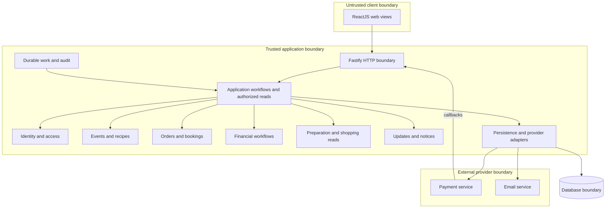

# Architecture

This document owns how the system is built. [REQUIREMENTS.md](REQUIREMENTS.md) owns behavior; [DESIGN.md](DESIGN.md) owns visual and interaction constraints. This is a design for a system with no implementation. Requirements marked ASSUMPTION in the source remain adopted first-release requirements. **PROPOSED** identifies an unconfirmed technical recommendation, **UNKNOWN** a missing fact, and **TO BE DECIDED** a pending decision.

## Required Architecture Inputs

| Field | Input |
| --- | --- |
| Requirements source | `REQUIREMENTS.md` |
| Design source | `DESIGN.md` |
| Target surfaces | Public and authenticated website, including narrow viewports, from the requirements. Mobile application scope is UNKNOWN; React Native is supplied separately as a developer choice. See AQ-2. |
| Runtime and deployment environment | Developer input names Fastify as the server runtime. Node.js is also specified, under server framework. These labels conflict with their technical roles; see AQ-1. Deployment environment is UNKNOWN. |
| Server framework | Developer input: Node.js. PROPOSED interpretation: Fastify framework running on Node.js, preserving both choices; confirmation is TO BE DECIDED in AQ-1. |
| Client framework(s) | Confirmed developer choices: ReactJS (web), React Native (mobile). Mobile scope remains unresolved. |
| API style and integration model | PROPOSED: HTTP JSON request/response API, cursor-based polling for staff updates, and server-side adapters for the required payment and email services. Provider callbacks and reconciliation enter application workflows. Providers are TO BE DECIDED. |
| Authentication and session model | Required: verified email, email-link sign-in, logout, dual Organizer/Attendee capability, Admin grants, and event-specific staff assignments. PROPOSED: revocable server-side sessions with an opaque browser cookie. Mobile session transport is TO BE DECIDED. |
| Data model and scale expectations | Required entities and state machines come from the requirements. Acceptance load: 1,000 launched events, 10,000 confirmed bookings, 200 active sessions, 20 user actions/second; growth expectations are UNKNOWN. PROPOSED: one relational database with transactions. |
| Security expectations | Required authorization, consent, audience filtering, audit, and retention boundaries are preserved below. Detailed controls are deferred to `SECURITY.md`. Jurisdictions and statutory duties are UNKNOWN. |

## Architecture and Decisions

**PROPOSED: a modular monolith**, using the Node.js/Fastify interpretation pending AQ-1, with a ReactJS web client and one PostgreSQL database. Logical modules separate business responsibilities without separate services. Transactions are necessary for seat allocation, booking confirmation, and financial deduplication; one database keeps these operations simple at the stated acceptance load. PostgreSQL selection remains unconfirmed. No separate message broker or cache is proposed.

**PROPOSED: application workflows coordinate domain rules and persistence through interfaces.** Domain rules do not depend on Fastify, React, SQL, or provider SDKs. HTTP handlers identify the actor, validate request shape, invoke workflows, and return audience-specific results. The server owns authorization, cutoffs, prices, transitions, and ingredient calculations. Client validation assists entry but cannot authorize a transition.

**PROPOSED: durable background work in the same application architecture.** Commit required notices, staff-update records, and outbound work with the originating state change. A database-backed dispatcher retries external work and scheduled tasks after restarts. Tasks cover hold/order expiry, event completion, refunds, payouts, email, reconciliation, and retention. This is a logical responsibility, not a deployment topology. Time-sensitive commands also check the server clock and stored deadlines; scheduler delay must not extend eligibility.

### API and frontend

**PROPOSED:** explicit command endpoints for actions such as launch, accept proposal, checkout, and cancel, plus read endpoints for public and authorized views. Do not expose arbitrary state updates. Return canonical states, field-specific errors, deadlines, and update cursors. Keep entered values on failed submissions (FR-1.12, FR-1.13). Stable public event URLs are also the only QR payload (FR-2.8, FR-2.9, FR-2.15).

**PROPOSED:** connected staff clients poll every two seconds using a durable cursor; on reconnect, fetch current authorized state and missed updates together. Bound responses with paging and use a consistent revision so an update is neither skipped nor mistaken for current state. The interval is a recommendation, not evidence that NFR-1.1–NFR-1.3 are met; validate end-to-end display latency under the required load. Detect connection failures, show the last successful update time, and retain focus and reading position.

ReactJS implements the calendar, event and account workflows, and staff/administration views justified by the requirements. Apply DESIGN.md tokens, permitted color pairs, system typography, content-driven reflow, exact state names, and accessible interaction patterns. Support keyboard actions, 200% text size, 320-pixel forms/details/lists, and stable live-update focus (NFR-3.1–NFR-3.6). Printing shopping lists and downloading QR codes belong to presentation; their data comes from authorized server reads.

React Native is a confirmed framework choice, but mobile feature coverage and platform targets are TO BE DECIDED. **PROPOSED:** reuse API contracts and presentation-independent formatting where appropriate; use platform-specific rendering and accessibility. Do not infer additional mobile features or treat mobile web support as a native-app specification.

### Persistence and consistency

**PROPOSED:** relational records for accounts and sessions; events and assignments; dishes, shared ingredients and recipe entries; orders, consent and proposals; holds and bookings; payments, refunds and payouts; notices, staff updates, audit records and pending work. Module ownership is defined below. Store USD amounts as integer cents and ingredient quantities as exact decimals. Store schedule instants with the event time-zone identifier; reject ambiguous or invalid local times until the Organizer resolves them.

Snapshot base recipes at launch and accepted recipes at confirmation so reusable-dish edits cannot change commitments (FR-7.8, FR-7.9). Preserve immutable published fields. Enforce one active order per Attendee/event and at most one booking per order through transactional constraints and workflows. Ingredient totals are derived from confirmed, uncancelled accepted recipes, grouped by ingredient identity and unit family, with the exact conversions, 10% extra, and upward rounding in FR-10.2–FR-10.11.

**PROPOSED:** serialize capacity-changing operations on the event record within short database transactions. Checkout, confirmation, cancellation, and capacity edits use the same locking rule; expired holds never count toward occupancy. Confirmation atomically replaces a valid hold with a booking. Never hold a database transaction open during a provider call. Persist operation identifiers and provider references to deduplicate callbacks, retries, refunds and payouts.

The provider owns its charge, refund and payout results; the application owns their validated local records and booking eligibility. A browser return cannot confirm payment. Validate provider evidence, amount, currency, hold validity, and event state before confirmation. Unknown payment results remain Pending and block another payment for that Attendee/event even if the hold expires. Late, incorrect, duplicate or cancelled-event payments trigger full refunds. Refund totals cannot exceed receipts; payouts exclude unresolved payments and refund obligations and cannot pay the same proceeds twice (FR-8.12–FR-8.24; FR-9.8–FR-9.18).

### Authentication and privacy boundaries

Email verification and sign-in links enter the identity workflow. **PROPOSED:** server-stored, revocable sessions; the web client holds only an opaque session identifier. Exact link/session lifetimes and mobile transport are TO BE DECIDED. Server workflows check current ownership, assignment, role, and suspension for every protected action and read. Suspension blocks new events/orders while preserving required cancellation/refund access (FR-6.12, FR-6.13).

Build separate public, Attendee, Organizer, cook, shopper, and Admin projections on the server. Public results exclude exact addresses and private records; addresses are restricted to the audiences in FR-2.12. Attendees see only their own orders/payments. Food-note sharing requires consent; shopper results exclude names and private notes, and emails exclude private notes and exact addresses. Revoking staff access applies to subsequent reads, including update replay (FR-3.10; FR-4.7; FR-4.14; FR-6.10; FR-11.1, FR-11.2).

Record actor, time and outcome for required state changes. **PROPOSED:** store private food-note content only in its owning records; updates, jobs and audit records refer to those records instead of copying notes. This allows consent withdrawal and 90-day deletion without leaving retained copies. Retain required financial references, amounts, states and action records for 24 months after last change, excluding private food notes (FR-11.3–FR-11.7). Detailed link protection, session controls, callback verification, operational access and retention controls belong in `SECURITY.md`.

## Components and Flows

Statuses describe how fully the responsibility is defined by the inputs; all module boundaries are PROPOSED. SUPPORTED does not mean implemented or tested.

| Logical component | Responsibilities and business-rule enforcement | Owned data | Status and exact requirement IDs |
| --- | --- | --- | --- |
| Web presentation | Render workflows, retain inputs, show canonical states and connection status; no authoritative business transitions | Transient form and view state only | SUPPORTED — FR-1.12, FR-1.13, FR-2.10, FR-5.2, FR-5.6, FR-10.12; NFR-3.1–NFR-3.6 |
| Mobile presentation | React Native supplied; workflow coverage unresolved | TO BE DECIDED | TO BE DECIDED — no native-app requirement ID |
| Identity and access | Verify/sign in/out; evaluate roles, suspension and current event access; Admin role management | Accounts, verification/sign-in records, sessions, role grants, suspension | PARTIALLY DEFINED — FR-6.1–FR-6.7, FR-6.10–FR-6.17; FR-11.2; session mechanics unresolved |
| Events and recipes | Event validation, launch checks, immutable snapshots, staff assignments, permanent URL/QR, calendar visibility | Events, assignments, reusable dishes, ingredients, event recipe snapshots | SUPPORTED — FR-1.1–FR-1.14; FR-2.1–FR-2.16; FR-5.1–FR-5.8, FR-5.10; FR-6.8, FR-6.9; FR-7.1–FR-7.8 |
| Orders and bookings | Consent, review/acceptance, order transitions, cutoff, capacity and hold rules, accepted recipe preservation, cancellation | Orders, food needs, consent, proposals, accepted recipes, holds, bookings | SUPPORTED — FR-3.1–FR-3.24; FR-5.9; FR-7.9, FR-7.10; FR-8.1–FR-8.9, FR-8.24; FR-9.1–FR-9.7, FR-9.11; FR-11.7 |
| Financial workflows | Account capability checks, payment validation, reconciliation, refund limits, payout eligibility and deduplication | Connected-account references/status, payment attempts, receipts, refunds, payouts, financial operation identifiers | PARTIALLY DEFINED — FR-2.5; FR-8.10–FR-8.23; FR-9.4, FR-9.7–FR-9.10, FR-9.12–FR-9.18; provider contract unresolved |
| Preparation and shopping reads | Deterministic totals, distinct variants, cook/shopper projections; exclude unpaid/cancelled orders | Derived results only; source ownership remains with events and orders | SUPPORTED — FR-4.5–FR-4.8; FR-10.1–FR-10.13 |
| Updates and notices | Durable staff history, reconnect replay, account notices, privacy-filtered email dispatch | Update references/cursors, account notices, delivery status | PARTIALLY DEFINED — FR-4.1–FR-4.14; NFR-1.1–NFR-1.3; email provider unresolved |
| Durable work and records | Dispatch scheduled/retry work through owning workflows; record audit outcomes and execute owner-defined retention | Pending-work metadata, audit records; no ownership of source business records | SUPPORTED — FR-2.16, FR-3.24, FR-8.7, FR-9.13, FR-11.3–FR-11.6; NFR-1.5, NFR-2.1 |

### Component and trust-boundary diagram

All internal boxes below are PROPOSED logical boundaries within one application, not independently deployed services. Native-app scope remains AQ-2.



### Main data flows

1. **Publish and discover:** Organizer input passes identity and event validation; launch checks complete recipes and payment-account capabilities before committing the launched snapshot and URL. Calendar/public reads return only approved public fields. The QR encodes that same URL; cancellation preserves it with a notice.
2. **Review and prepare:** submission persists an order and staff update atomically. Unchanged orders become Ready for Payment; changed dishes require Organizer proposals and Attendee acceptance. Neither review nor acceptance reserves a seat. Confirmed recipes feed cook views and deterministic shopping totals. Shopper projections remove identity and private notes before crossing the client boundary.
3. **Cancel and settle:** eligible cancellation commits the cancellation, released seat, update and refund work together. Provider results update financial state without restoring attendance. Event cancellation cancels all active orders and initiates refunds for paid bookings. Completion initiates an eligible, deduplicated payout. Background retries and Admin reconciliation use the same workflows as callbacks.
4. **Notify and reconnect:** committed update references feed authorized polling and account notices. Email delivery is independent of notice persistence. Reconnection returns current state and missed history; clients display staleness until refreshed. Retention tasks invoke owners to delete private notes and age financial records according to the required periods.

```mermaid
sequenceDiagram
  actor Attendee
  participant API as Application workflows
  participant DB as Transactional store
  participant Pay as Payment service
  participant Staff as Staff view
  Attendee->>API: Checkout accepted order
  API->>DB: Check access, cutoff, unresolved payments; atomically reserve seat
  DB-->>API: Persisted hold and payment attempt
  API->>Pay: Initiate full-price payment with operation identity
  API-->>Attendee: Checkout details and hold expiry
  Pay->>API: Payment result (callback or reconciliation)
  API->>DB: Deduplicate and validate payment, event and hold
  alt Correct payment during valid hold
    API->>DB: Replace hold with booking; persist updates and notices
  else Late, incorrect, duplicate or cancelled-event payment
    API->>DB: Persist full-refund work; no new confirmed booking
  else Result unresolved
    API->>DB: Keep payment Pending; block another payment
  end
  Staff->>API: Poll after saved cursor
  API->>DB: Read current authorized state and updates
  API-->>Staff: Filtered update and current preparation totals
```

## Dependency Rules

- **DR-1:** Presentation depends only on API contracts and design/formatting utilities. Clients never access the database or authorize business transitions.
- **DR-2:** HTTP handlers and durable-work entry points call application workflows; workflows call domain policies and interfaces. Domain code never imports presentation, transport, persistence or provider code.
- **DR-3:** Infrastructure adapters implement interfaces owned by the application/domain boundary. Wiring supplies them to workflows; business code does not import concrete adapters. Logical dependencies remain inward even when runtime calls reach a vendor.
- **DR-4:** Each persisted business record has exactly one owner from the component table. Only that owner's operations mutate it. Cross-owner workflows coordinate these operations in a shared transaction; modules do not modify another owner's tables directly.
- **DR-5:** Cross-module orchestration lives above the modules. Modules never call back into orchestration or form mutual dependencies. Access checks receive ownership/assignment facts through interfaces; event modules do not depend on identity storage internals.
- **DR-6:** Source records flow into audience-specific reads and derived totals, then into presentation. Derived results, notifications and client state cannot write back as authoritative orders, recipes or financial results.
- **DR-7:** Business changes flow into transactional update/work records, then delivery adapters. Callback handlers and retries re-enter workflows with deduplication; delivery success never substitutes for a business-state commit.
- **DR-8:** External services are reached only through adapters. Provider payloads become validated application facts before affecting bookings or balances. Private data is filtered before every client/provider boundary, including update replay and email.

## Open Questions

- **AQ-1 — Input terminology:** Node.js was supplied as framework and Fastify as runtime. PROPOSED interpretation is Node.js runtime with Fastify framework; acceptance of that correction is TO BE DECIDED. Neither technology is replaced.
- **AQ-2 — Native scope:** Requirements define a website and responsive accessibility, while developer inputs also specify React Native. Native platforms, release scope, workflow parity, link handling, printing and accessibility mapping are TO BE DECIDED; platform facts are UNKNOWN.
- **AQ-3 — Payment provider:** Selection and supported connected-account, callback, reconciliation, refund, fee and post-completion payout contracts are TO BE DECIDED. Provider durations are UNKNOWN. Selection must support full refunds, no extra Attendee fees, and the required payout timing; incompatible capabilities must be flagged.
- **AQ-4 — Email and sessions:** Email provider, sign-in/verification link lifecycle, session lifetime, revocation behavior and native credential transport are TO BE DECIDED. First Admin provisioning is also TO BE DECIDED without weakening FR-6.11.
- **AQ-5 — Persistence and execution:** Acceptance of PostgreSQL, transaction/locking details, durable-work retry/reconciliation policies, and runtime/library versions is TO BE DECIDED. Hosting environment is UNKNOWN; operational choices must meet restart durability and 99.5% monthly read availability without inventing growth targets.
- **AQ-6 — Update transport:** Acceptance of two-second cursor polling is TO BE DECIDED after testing all staff display/reconnect limits under the specified load, including polling traffic. Any transport change must preserve durable replay and current-assignment checks.
- **AQ-7 — Privacy lifecycle:** Jurisdictions are UNKNOWN. Exact classification of private food notes versus retained recipe/handling data, deletion across derived records/backups, and post-event retention of nonfinancial notices/updates are TO BE DECIDED in coordination with `SECURITY.md`. Required 90-day deletion, consent withdrawal, financial exclusion and 24-month retention remain binding.
- **AQ-8 — Frontend constraints:** DESIGN.md DQ-1–DQ-3 remain pending. Browser support and native equivalents for design tokens are TO BE DECIDED; those decisions cannot relax NFR-3 or add unsupported workflows.
